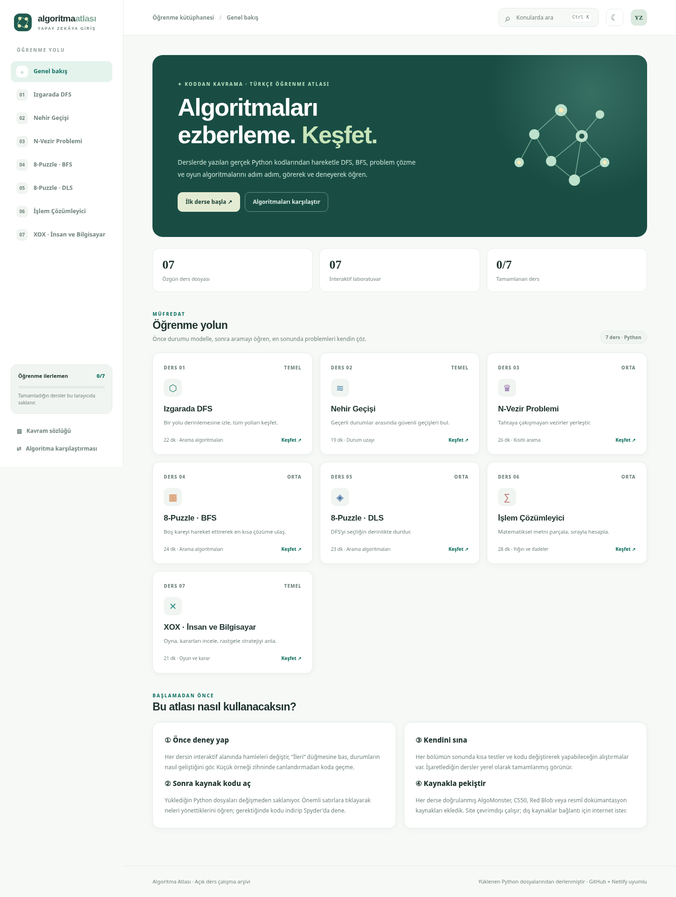

# Algoritma Atlası — Yapay Zekâya Giriş

Türkçe, ücretsiz, etkileşimli bir ders arşivi. Ders sırasında yazılan gerçek Python uygulamaları üzerine inşa edilmiştir; öğrencinin konuyu **önce görmesi, sonra kodla ilişkilendirmesi ve son olarak kendini sınaması** hedeflenmiştir.



## İçerik

| Ders | Python kaynağı | İnteraktif bölüm |
| --- | --- | --- |
| 01 — Izgarada DFS | `codes/01_dfs_izgara.py` | 3×3 / 4×4 DFS durumlarını adım adım izleme |
| 02 — Nehir Geçişi | `codes/02_nehir_gecisi.py` | Geçerli durumlar üzerinden kıyı geçişleri |
| 03 — N-Vezir | `codes/03_n_vezir.py` | 4–8 vezirlik geri izleme / tehdit alanı |
| 04 — 8-Puzzle BFS | `codes/04_8_puzzle_bfs.py` | Katmanlı arama ve çözüm yolu |
| 05 — 8-Puzzle DLS | `codes/05_8_puzzle_dls.py` | Derinlik sınırını değiştirerek sonuçları gözleme |
| 06 — İşlem Çözümleyici | `codes/06_ifade_cozme.py` | Güvenli dört işlem ayrıştırıcısı, ara adımlar |
| 07 — XOX | `codes/07_xox.py` | Rastgele hamle yapan bilgisayara karşı oyun |

Her ders: öğrenme hedefleri, ayrıntılı konu anlatımı, görsel deney, sözdizimi vurgulu *tam Python kaynağı*, değişken sözlüğü, hatalar, Spyder alıştırmaları, mini test ve dış kaynak bağlantılarını içerir.

## Kurulum gerektirmez

Bu site **saf HTML + CSS + JavaScript** kullanır. React/Vite/npm, paket kurulumu, veritabanı veya API anahtarı gerektirmez.

- `index.html` — giriş sayfası
- `styles.css` — ferah, mobil uyumlu açık/koyu tema
- `content.js` — ders içerikleri, testler ve kaynak URL'leri
- `app.js` — menüler, ilerleme, kod görüntüleme ve yedi interaktif deney
- `codes/` — kullanıcının sağladığı yedi ayrı Python dosyasının **içerik değiştirilmeden** kopyaları
- `netlify.toml` — Netlify statik yayın ayarı

> Kaynak Python dosyalarının isimleri arşivde numaralı ve okunabilir şekilde yeniden adlandırıldı; **içerikleri değiştirilmedi**. İki XOX yüklemesi aynı içerikte olduğundan tek dosya saklandı.

## GitHub'dan Netlify'a yayımlama

Ayrıntılı adımlar: [DEPLOY.md](DEPLOY.md).

Kısa versiyon:

1. Bu ZIP'in içeriğini çıkar. GitHub'da boş bir depo oluştur.
2. `index.html`, `app.js`, `content.js`, `styles.css`, `codes/`, `preview.png`, `netlify.toml` ve diğer dosyaları deponun köküne yükle.
3. Netlify → **Add new project** → **Import an existing project** → GitHub ile bağlan → deponu seç.
4. **Build command:** boş bırak; **Publish directory:** `.` (nokta).
5. Deploy'u başlat. Sonrasında GitHub'a gönderdiğin güncellemeler otomatik yayımlanır.

Yerelde `index.html` dosyasını doğrudan çift tıklamak yerine, kodların `fetch` ile yüklenmesi için bir HTTP sunucusu kullan:

```bash
cd Yapay_Zeka_Algoritma_Atlasi
python -m http.server 8000
```

Ardından `http://localhost:8000` adresini aç. Netlify'da buna ihtiyaç yoktur.

## Doğruluk ve sınırlar

- **Python dosyaları:** paylaşılan sürümler aynen sunuluyor. Kod çalıştırma tarayıcıda yapılmıyor. Python dosyaları sözdizimi kontrolünden geçirildi; interaktif Matplotlib gibi masaüstü davranışları tarayıcıdan yürütülmez.
- **İnteraktif deneyler:** Python dosyalarının mantığını **JavaScript ile öğretici amaçlı canlandırır**. 8-Puzzle BFS demosu tekrar durumları engeller; bu iyileştirme kaynak Python sürümünde yoktur. Nehir geçişi demosu bir kısa yolu BFS ile gösterebilir; kaynak Python DFS ile çalışır.
- **8-Puzzle:** 2×3 kaynaklar dış eğitim materyalidir; bizim tahtamız 3×3'tür.
- **XOX:** Kaynak bilgisayar hamlesi rastgeledir, Minimax değildir. İleride Minimax eklemek bir sonraki öğrenme projesidir.
- **İşlem çözücü:** yalnız +, −, ×, ÷, parantez ve temel sayıları destekler. `sqrt`, `sin`, `cos`, `tan`, `exp`, `log` yüklenen dosyada uygulanmış değildir. Tarayıcı kodu `eval` kullanmaz.
- **İlerleme:** yalnızca tarayıcının `localStorage` alanında tutulur; oturum veya bulut hesabı yoktur.
- **Dış kaynaklar:** bağlantılar internet gerektirir. AlgoMonster'ın bazı içerikleri üyelik/ücret sınırlarına tabi olabilir.

### Testler

- 4×4 ızgara DFS: **184** yol.
- N-Vezir: 4×4 **2**, 8×8 **92** geçerli çözüm.
- 8-Puzzle BFS: örnek başlangıç **2** hamlede hedefe ulaşıyor.
- DLS: aynı başlangıç için sınır 1 → hedef bulunamadı; sınır 2 → hedef bulundu.
- Nehir geçişi: geçerli bir rota ile hedefe erişiliyor.
- Hesaplayıcı: `5*(3+2)-8/2 = 21`, `8/4*2 = 4`.
- XOX: hamle, kazanma ve yeniden başlatma davranışı test edildi.
- Test sırasında tarayıcı JavaScript hatası gözlenmedi; mobilde yatay taşma görülmedi.

## Eğitim materyali notu

Python kodları ders materyallerinden ve öğrenci tarafından paylaşılan çalışmalardan gelmektedir. Kamuya açık paylaşım öncesinde ders hocasının materyalinin yayımlanmasına ilişkin izinleri ve varsa kaynak gösterme şartlarını kontrol edin. Dış kaynaklar yalnızca bağlantı şeklinde sunulmuştur, üçüncü taraf metin ve videolar yeniden yayımlanmamıştır.
